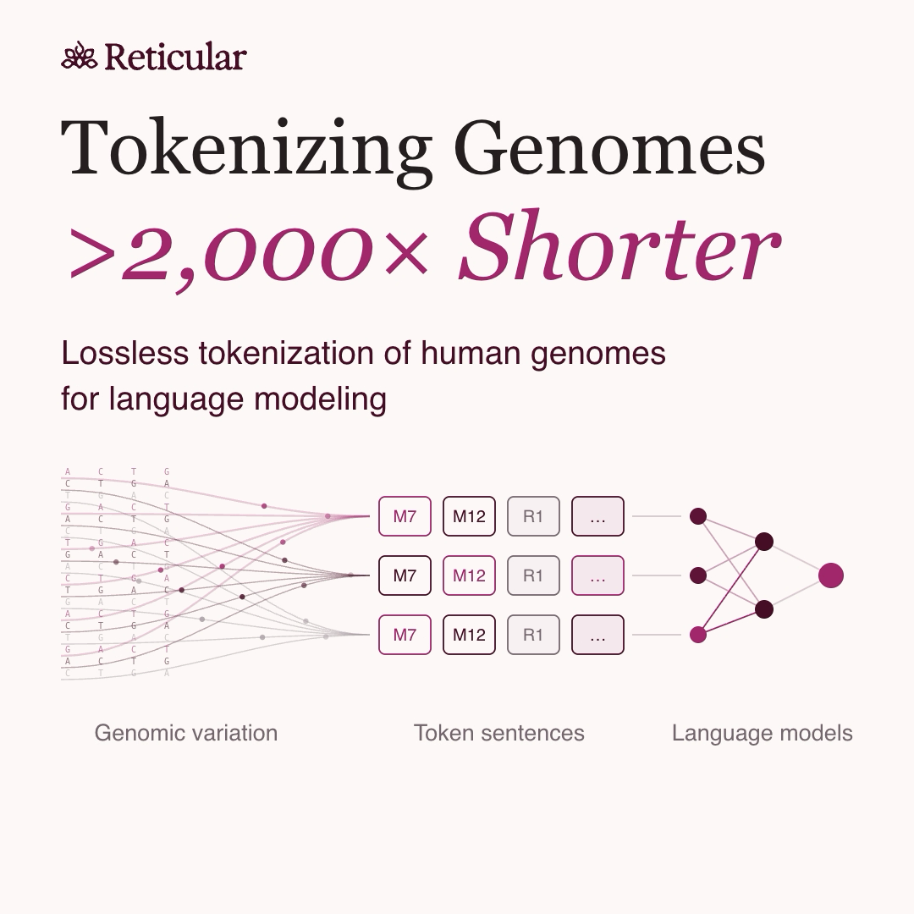

# Reticular - Tokenizing human genomic variation into >2,000x shorter sequences

[](https://github.com/reticular-ai/reticular-genome-tokenization/actions/workflows/test.yml)
[](LICENSE)

Reticular represents diploid genetic variation as **motif tokens plus lossless residuals**, for exact dosage reconstruction and sequence modeling.

[](https://github.com/reticular-ai/reticular-genome-tokenization/blob/main/figures/tokenizer-explainer.mp4)

*[Watch the 48-second explainer](https://github.com/reticular-ai/reticular-genome-tokenization/blob/main/figures/tokenizer-explainer.mp4). The video uses the earlier ≈707-token internal example; current cohort-specific results appear below.*

In a **2.76 Mb region on chromosome 22**, our All of Us model achieves **712 tokens/person** and **0.553 holdout CE (nats/token)** across **5,320 new individuals**, after training on 268,491 people. The checkpoint was selected before this holdout evaluation.


The headline compares regional base span with token count (~3,870 bases per token), **not byte compression of a complete DNA sequence**. A reference, allele catalog and dictionary are shared side information. The result covers selected new participants with recorded family components absent from original training; the broader historical split is not claimed pristine. [Full biobank results and evaluation scope →](docs/biobank.md)

## Reproduce it with public data

This repository provides an independently fitted **1000 Genomes tokenizer** for the same region:

- **1,452 content tokens** per validation person, on average; **8,192 vocabulary IDs**.
- **Exact reconstruction for all 455 development individuals** across 82,401 allele-specific variants.
- **7.37× fewer tokens** than the two-token-per-entry residual baseline.

The public cohort has 400 training, 55 validation and 48 reserved test individuals, grouped by known pedigree. Fitting uses training people only; validation informed development and the test remains unscored. The public and biobank experiments are not a matched scaling comparison.

[Benchmark figures and methods](docs/methods.md) · [Reproduction guide](docs/reproduction.md) · [Aggregate data](results)

## Quick start

Python 3.11 or 3.12; CPU only. This synthetic example needs no genotype download.

```bash
git clone https://github.com/reticular-ai/reticular-genome-tokenization.git
cd reticular-genome-tokenization
python -m venv .venv
source .venv/bin/activate
python -m pip install -r requirements.txt
python examples/roundtrip.py
```

The example verifies the frozen dictionary checksum and exact reconstruction. To reproduce the cohort benchmark, follow the [download and preprocessing guide](docs/reproduction.md).

## Release scope

**Included:** frozen motifs, variant mapping, deterministic encoder/decoder, public-data pipeline, aggregate results and figure-generation code. **Proprietary:** vocabulary discovery and fitting. Biobank participant data and model weights are not included. Supplementary modeling recipes and their evaluation limitations are in [RESEARCH.md](RESEARCH.md).

[Tests and contributing](CONTRIBUTING.md) · [File checksums](SOURCE_MANIFEST.json) · [Provenance review](RELEASE_REVIEW.md) · [MIT license](LICENSE)

## Cite and acknowledge

Cite this software using [CITATION.cff](CITATION.cff) and the source data using [Byrska-Bishop et al., Cell 2022](https://pmc.ncbi.nlm.nih.gov/articles/PMC9439720/). We acknowledge the donors, IGSR, Coriell, NYGC and NHGRI; [full acknowledgements and provider terms](docs/methods.md#data-acknowledgements).
