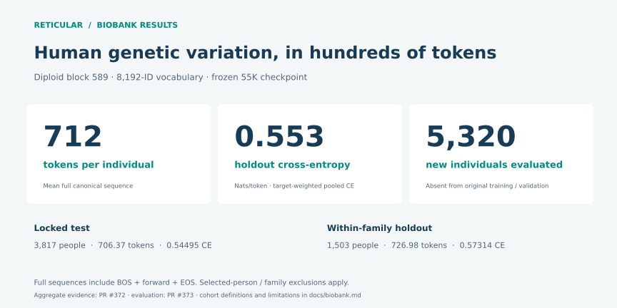
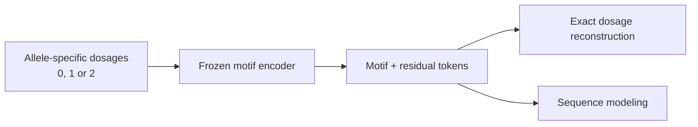

# Reticular - Tokenizing human genomic variation into >2,000x shorter sequences

[](https://github.com/reticular-ai/reticular-genome-tokenization/actions/workflows/test.yml)
[](LICENSE)

**Biobank-scale genetic variation in hundreds of tokens, modeled autoregressively.**

The headline compares the **2.76-million-base regional span** with the biobank’s **712-token mean full sequence**—approximately **3,870 bases of span per token**. It describes representation length, not byte compression of a complete DNA sequence: the reference, allele catalog and dictionary are shared side information. The independently fitted public demo averages ~1,450 tokens, or approximately 1,900 bases of span per token.

Our All of Us block 589 experiment represents diploid genetic variation in **712 tokens per person on average** and achieves **0.553 pooled holdout cross-entropy (nats/token)** across **5,320 new individuals**. The model was trained on **268,491 individuals**; its reporting checkpoint was selected using the original 1,000-person validation set before the new holdout evaluation.

On the **3,817-person locked-test cohort**, the mean full sequence is **706 tokens** and CE is **0.545**. A further **1,503 within-family holdout individuals** bring the new evaluation to 5,320 people. Full sequence lengths include three framing tokens. [Exact results and evaluation scope →](docs/biobank.md)

This repository provides the **publicly reproducible companion**: a frozen tokenizer fitted independently on 1000 Genomes training data, with **1,452 tokens per validation individual** across a 2.76 Mb region and **exact reconstruction for all 455 development individuals**. Encoding and reconstruction require no private infrastructure.

[Biobank results](#biobank-scale-language-modeling) · [Public benchmark](#public-data-benchmark) · [Quick start](#quick-start) · [Reproduce](docs/reproduction.md) · [Methods](docs/methods.md)

## Biobank-scale language modeling

The **preselected 55K checkpoint** was evaluated with the unchanged **8,192-ID tokenizer**. New participants were absent from the original training/validation corpus, and their recorded family components were absent from original training.

| New reporting cohort | People | Mean full sequence tokens | CE (nats/token) |
|---|---:|---:|---:|
| Locked-test holdout | 3,817 | 706.37 | **0.54495** |
| Within-family holdout | 1,503 | 726.98 | 0.57314 |
| Pooled | **5,320** | **712.19** | **0.55308** |



The checkpoint was fixed before this evaluation. The [detailed results](docs/biobank.md) retain all three checkpoint endpoints, including later deterioration. Results and lengths come from [PR #372](https://github.com/reticular-ai/pgs/pull/372), with evaluation implementation in [PR #373](https://github.com/reticular-ai/pgs/pull/373). The publicly readable [aggregate record](results/biobank-holdouts.json) preserves exact values.

The broader historical canonical partition is not claimed pristine: this result is defined by the selected new participants and stated original-training family exclusions. The biobank and public experiments use different fitted dictionaries, cohorts and model configurations, so this is not a matched scaling comparison. [Protocol, historical validation curve, and evidence limits →](docs/biobank.md)

## Genetic variation as a token sequence

People share much of their genetic variation. A motif token represents a recurring set of allele dosages; residual tokens preserve the variation that motifs do not cover. The result is a deterministic sequence that can be decoded exactly and used as input to sequence models.



This encodes **genetic differences relative to a shared reference and allele catalog**. It does not compress an entire nucleotide string or preserve haplotype phase. Selected motifs, token meanings, and inference code are public; vocabulary discovery and fitting remain proprietary.

## Public-data benchmark


*Counts are means over 55 validation individuals. A nonreference allele entry is not itself a serialized token. The residual-only grammar uses two tokens per entry; the motif representation uses 7.37× fewer tokens than that baseline. Shared reference and dictionary storage are additional costs.*

| Content sequence statistic | Training (400 people) | Validation (55 people) |
|---|---:|---:|
| Mean tokens | 1,208.8 | **1,451.9** |
| Median | 1,188.5 | 1,427 |
| 95th percentile | 1,463.3 | 1,762.5 |
| Maximum | 1,985 | 1,875 |
| Motif share of emitted tokens | 37.36% | 32.42% |
| Residual-only mean | 10,650.6 | 10,705.2 |
| Exact reconstruction | 400 / 400 | 55 / 55 |

**Region:** GRCh38 chr22:43,317,956–46,074,513, inclusive (block 589). **Catalog:** 82,401 normalized allele-specific variants. **Dictionary:** 3,662 motifs, each with D1/D2 dosage states; 8,192 total IDs including residual and special tokens. Model framing adds three tokens per person.

The 503-person EUR cohort is partitioned by known pedigree components into 400 training, 55 validation, and 48 reserved test individuals. Fitting uses training individuals only. Validation informed development; the reserved test is unscored. [Full methods and limitations →](docs/methods.md)

### Motif use has a long tail


*Only motif tokens are counted; residuals and framing are excluded. D1 and D2 are separate types. Each split is ranked independently. The common head and rare tail are visible in both splits; this descriptive plot does not establish a Zipf law.*

The [aggregate CSVs](results) include zero-occurrence types, and the [reproduction guide](docs/reproduction.md#2-reproduce-motif-frequencies) explains how to regenerate them from canonical streams without counting overlapping windows twice.

## Quick start

Python 3.11 or 3.12; CPU only. No genotype download is needed for this example.

```bash
git clone https://github.com/reticular-ai/reticular-genome-tokenization.git
cd reticular-genome-tokenization
python -m venv .venv
source .venv/bin/activate
python -m pip install -r requirements.txt
python examples/roundtrip.py
```

Expected output:

```text
Exact synthetic round-trip: 82,401 allele dosages, 3 tokens.
```

The example creates synthetic dosages using one released motif and a residual, verifies the vocabulary checksum, and asserts exact reconstruction. Its three-token output is an illustration, not a person's benchmark result.

**Next:** [download the public calls and reproduce the measured benchmark](docs/reproduction.md). The source VCF is approximately 446 MB; full preparation requires bcftools. The tokenizer itself can run with NumPy alone via `tokenizer/codec.py`.

## What is in this release?

| Component | Status |
|---|---|
| Frozen block 589 vocabulary, variant map, encoder and decoder | Released; checksummed |
| Public-data download, preprocessing and benchmark pipeline | Released |
| Compression and motif-frequency aggregates; figure-generation code | Released |
| Reviewed biobank NTP aggregate curve | Released; controlled-data experiment not independently reproducible here |
| Public causal-model and synthetic-teacher recipes | Experimental; see [research notes](RESEARCH.md) |
| Trained model checkpoints | Not included |
| Vocabulary discovery and fitting algorithms | Proprietary; not included |

The public small-model experiments are supplementary. Their archived window-owned NTP scores have an evaluation caveat and are not presented as normalized complete-stream likelihoods. This repository's independently reproducible claim is frozen-dictionary tokenization and reconstruction.

## Tests and provenance

```bash
python -m pip install '.[test]'
python -m pytest -q tests/test_frozen_diploid.py tests/test_release_bundle.py tests/test_motif_frequency.py
```

CI checks the codec, shipped artifact hashes, public preprocessing and acquisition logic on Python 3.11 and 3.12. [SOURCE_MANIFEST.json](SOURCE_MANIFEST.json) records release-file hashes; [release review](RELEASE_REVIEW.md) documents verification scope. Contributions and reproduction reports are welcome: see [CONTRIBUTING.md](CONTRIBUTING.md).

## Citation and acknowledgements

Use [CITATION.cff](CITATION.cff) to cite this software, including the commit you used. Cite the underlying data publication separately.


The data are from [IGSR's high-coverage 1000 Genomes collection](https://www.internationalgenome.org/data-portal/data-collection/1000genomes_30x/). Cite [Byrska-Bishop et al., Cell 2022](https://pmc.ncbi.nlm.nih.gov/articles/PMC9439720/). Samples originated from the NIGMS Human Genetic Cell Repository at the Coriell Institute for Medical Research; sequencing was generated at the New York Genome Center with NHGRI support (3UM1HG008901-03S1 and 3UM1HG008901-04S2). We acknowledge the sample donors. See the [provider acknowledgement statement](https://ftp.1000genomes.ebi.ac.uk/vol1/ftp/data_collections/1000G_2504_high_coverage/20200526_1000G_2504plus698_high_cov_data_reuse_README.txt). Source data retain their providers' terms.
