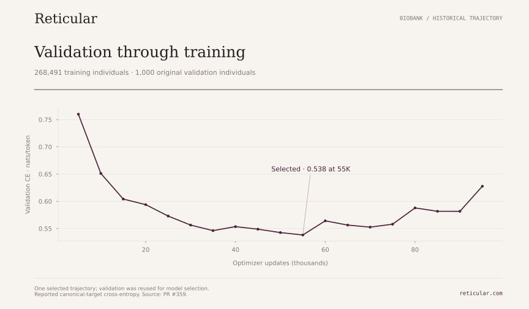

# Biobank-scale diploid next-token prediction

A separate All of Us block 589 campaign trained on **268,491 individuals** and evaluated on **1,000 held-out validation individuals**, using a genotype-only overlapping-motif dictionary with **8,192 model token IDs**. The retained production encoding record reports zero reconstruction failures. The author reports a mean sequence length of **707 tokens/person**, calculated in the Tokenization Media session. The reviewed curve reaches validation cross-entropy around **0.55 nats/token**, with a best recorded endpoint of **0.5381517655643108 at 55,000 updates**.

The full curve and original metric definitions are preserved in [the aggregate JSON](../results/biobank-ntp.json), copied unchanged from Reticular's [PR #359](https://github.com/reticular-ai/pgs/pull/359), revision `7f44d508697e72478131691471a427e0520fd9d0`. The source repository requires access; the aggregate record here is publicly readable. These measurements were extracted from retained run records, not rerun for this release.

## Protocol and interpretation

The training integration describes a Kimi-derived hybrid KDA/dense-attention model with MoE, Engram, Lorentz features, width 768, 12 layers and eight heads. Context-256 windows use stride 128; the reported validation metric counts canonical targets once across overlapping windows. The published integration source is a reference for the architecture, not proof of the exact executed parameter count or a reproducible controlled-data training archive.

The same validation partition selected learning rate and checkpoint. The best recorded endpoint is at 55K; CE then rises to **0.6276512535472633 at 95K**. The original schedule had a 200K horizon, but the retained records show user cancellation rather than completion of 200K. One selected trajectory is reported, without seed-replication confidence intervals.

Historical training/validation membership was preserved. The audit did not verify its mapping onto canonical discovery/tuning roles or all preprocessing, dictionary/topology-fitting and relatedness exclusions required for a strictly inductive claim. The result is development performance, without independent test confirmation.

## Relationship to the public demonstration

The biobank and 1000 Genomes experiments differ in cohort, fitted dictionary, model and training budget. Their CE values are **not a matched scaling comparison**. The public dictionary is independently fitted on public training data; no biobank dictionary, graph features, participant data or weights are released here.

The **707-token mean** is an author-supplied aggregate, authorized for inclusion on 2026-11-09, rather than a value in PR #359. Its underlying calculation, precise averaging population and framing convention were not independently checked in this release review. The separate [length provenance record](../results/biobank-length.json) preserves that distinction. Complete-stream bits/person are unavailable and are not derived by multiplying this rounded mean by CE.
