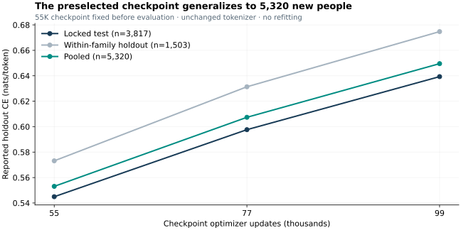

# Biobank-scale diploid next-token prediction

The model trained on **268,491 individuals** was evaluated on the original **1,000-person validation set** and then **5,320 new reporting-holdout participants**. The latter evaluation kept the original **55K checkpoint preselected** and the **8,192-ID diploid tokenizer unchanged**. No model training, dictionary refitting or checkpoint reselection occurred.

## New-person holdout results

| Checkpoint | Locked test (3,817 people) | Within-family holdout (1,503 people) | Pooled (5,320 people) |
|---|---:|---:|---:|
| **55K — preselected** | **0.5449470382844914** | **0.5731373727181317** | **0.5530771567511026** |
| 77K | 0.5976446652432101 | 0.6313640730284626 | 0.6073693735670295 |
| 99K | 0.6393433627864198 | 0.6747438155122466 | 0.649552886022483 |

CE is canonical-target cross-entropy in nats/token, using context 256 and stride 128. Each content target is owned by its lowest frozen window row; one true EOS is scored per person. Padding and BOS/forward prefixes are unscored. Pooled CE is summed NLL divided by summed target count, not an unweighted mean of cohort CEs. The run used float32, pure-forward scoring and batch size 72. Original 55K validation was replayed within the predeclared 0.0001 nats/token tolerance before holdout scoring.

The selected new people were absent from the original training and validation corpus; their recorded family components were absent from original training. Only these 5,320 people and three checkpoints were evaluated in this follow-up, not the full remaining European-ancestry cohort. The later deterioration supports retaining the preselected checkpoint, without selecting a replacement on these holdouts.

## Verified sequence lengths

| Cohort | People | Mean content tokens | Mean full sequence tokens |
|---|---:|---:|---:|
| Original training | 268,491 | 706.1875183898156 | 709.1875183898156 |
| Original validation | 1,000 | 701.26 | 704.26 |
| New locked-test holdout | 3,817 | 703.3699240241027 | 706.3699240241027 |
| New within-family holdout | 1,503 | 723.9787092481703 | 726.9787092481703 |
| New holdouts pooled | 5,320 | 709.1922932330828 | 712.1922932330828 |

Full sequence means the canonical participant stream before windowing, including BOS, forward marker and EOS: content length plus three. These measured split-specific means supersede the earlier author-reported approximation of 707 tokens/person, retained only as a historical provenance record in `results/biobank-length.json`.

Mean unpadded window length is 242.25613714003242 across the original training and validation cohorts combined. This is neither a full-sequence mean nor a split-specific statistic. Complete-stream bits/person are not reported here.

## Historical validation and model selection

The original 1,000-person validation set selected learning rate and checkpoint. Its best recorded CE was **0.5381517655643108 at 55K updates**; recorded CE increased to **0.6276512535472633 at 95K**. The 200K schedule horizon was not a completed run: retained records show user cancellation. The original [PR #359 aggregate](../results/biobank-ntp.json) remains unchanged.

The training integration describes a larger Kimi-derived model with hybrid KDA/dense attention, MoE, Engram, Lorentz features, width 768, 12 layers and eight heads. It is an architecture reference, not proof of the exact executed parameter count. The frozen allele universe is retained in the new evaluation; alleles outside that support are outside this result.

## Evidence scope and reproducibility

Exact holdout losses and sequence lengths are copied from [PR #372](https://github.com/reticular-ai/pgs/pull/372), pinned revision `c8f5fa39eef5763abbe8441b7a4aac9a601192e1`, into the public [aggregate JSON](../results/biobank-holdouts.json). Evaluation implementation is in [PR #373](https://github.com/reticular-ai/pgs/pull/373), revision `4674d472334c95c7ac62de1a2a99c003b7a7e1fb`. Those source PRs require private-repository access; all numbers used by this page are readable in this public repository. The publication update did not rerun controlled-data evaluation.

The historical model had already used some people assigned to present-day canonical holdout roles. The broader canonical partition is therefore not claimed pristine. The explicit selected-person exclusions and absence of their recorded family components from original training define this evaluation. “Within-family” names a token-CE cohort; it does not measure within-family phenotype effects or PGS attenuation.

No matched token-frequency/Markov baseline, seed-replicated uncertainty interval or downstream prediction claim is established. Cohort composition differs from original validation, so CE changes cannot be attributed to cohort size alone. Biobank and 1000 Genomes results differ in dictionary, cohort, model and training budget; they are not a matched scaling experiment.

Only aggregate metrics are released. Biobank participant data, dictionary, graph features, checkpoints and operational mappings remain protected. The public tokenizer is independently fitted on public training data; it is the reproducible companion, not a reproduction of controlled-data model training.
