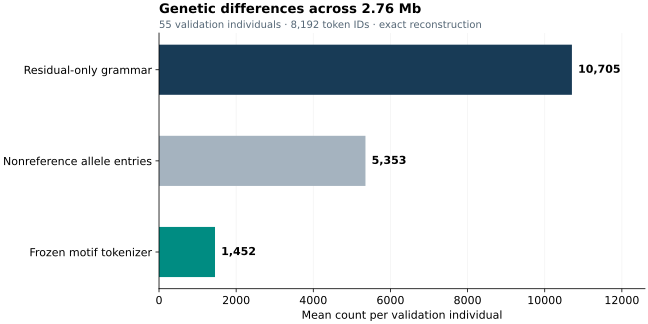
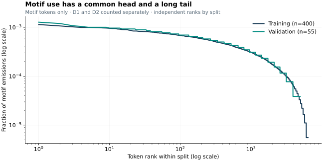

# Representation and evaluation

## The object being encoded

The input is one allele-specific dosage vector, with entries in {0, 1, 2}, aligned to a fixed GRCh38 chromosome/position/REF/ALT catalog. A multiallelic site contributes one entry per retained ALT allele. Homozygous-reference entries are implicit zeros. This is a representation of callable genetic differences, not a FASTA compressor or a representation of haplotype phase. Missing calls fail preparation rather than being imputed.

The benchmark interval is chr22:43,317,956–46,074,513, inclusive (2,756,558 bases). The catalog has 82,401 normalized sequence-allele identities from the external release, including alleles absent from this EUR subset. The pipeline applies the frozen reference-normalization and sequence-allele rules in `configs/data.json`; it does not select a cohort-dependent MAF threshold. Symbolic structural variants and VCF annotations are outside the representation.

## Frozen motifs and residuals

A motif is a selected set of allele ranks. Each motif has two token states: D1 covers dosage 1 at its ranks, and D2 covers dosage 2. Overlapping motif coverage combines by elementwise maximum. The deterministic encoder selects compatible motifs using the frozen inference ordering, then emits residuals for the remaining dosage. The discovery process that selected the motif sets is proprietary; the selected sets and inference procedure are fully visible.

Each residual is an adjacent R1/R2 pair. R1 specifies the remaining dosage and a coarse allele address; R2 specifies the fine address. With the released dimensions, allele rank is `coarse * 288 + fine`. The decoder combines motif coverage and residual dosage, rejecting malformed pairs and dosage overflow. The complete grammar and IDs are in [tokenizer/config.json](../tokenizer/config.json).

A synthetic illustration:

| Allele rank | 0 | 1 | 2 | 3 |
|---|---:|---:|---:|---:|
| Input dosage | 1 | 1 | 2 | 0 |
| D1 motif covering {0, 1} | 1 | 1 | 0 | 0 |
| Residual pair for rank 2, remaining dosage 2 | 0 | 0 | 2 | 0 |
| Decoded dosage | 1 | 1 | 2 | 0 |

This illustration uses one motif token plus one residual pair. It does not describe a particular participant or a measured compression result. [The runnable example](../examples/roundtrip.py) instead exercises an actual released motif with synthetic dosages.

## What the baselines mean

For validation individuals, the mean number of nonreference allele-specific entries is 5,352.62. The residual-only baseline encodes each entry with two tokens, giving 10,705.24 tokens. The frozen motif tokenizer needs 1,451.91 content tokens on average: **7.37× fewer than this residual-only grammar**, or **3.69× fewer tokens than nonreference entries**. The entry count is a descriptive baseline, not a competing serialized codec with equal vocabulary or byte cost.

Token count is not file size or Shannon entropy. A full comparison of compressed bytes would need a probability model and account for the shared reference, variant catalog, dictionary, framing and decoder. The released vocabulary NPZ is 918,416 bytes; the separate compressed variant mapping is 513,368 bytes. These are additional shared storage, not amortized into the reported token lengths.

## Evaluation population and split

The public panel defines 503 European-ancestry individuals. Deterministic assignment of complete known pedigree connected components produces 400 training, 55 validation and 48 reserved test people. Related people identified by that pedigree cannot cross splits; cryptic relatedness has not been excluded by genome-wide kinship estimation.

The vocabulary was fitted on training people only. Validation informed development, so these results are development performance, not a final blind-test estimate. All 455 development individuals reconstruct exactly. The reserved test is excluded from encoding, benchmark scoring, and the motif-frequency analysis presented here.

## Motif frequency

Count each canonical content stream once. D1 and D2 are separate types; residuals and special tokens do not enter the numerator or denominator. Frequency is a token type's occurrence count divided by all motif occurrences in that split. Curves rank types independently within training and validation. Zero-occurrence types remain in the CSVs but cannot appear on logarithmic axes.

The distribution has a common head and a long tail. We do not claim a verified Zipf law or power-law model: approximately linear portions of a log-log plot do not establish that distributional form. These are frequencies of emitted selected motifs, not population frequencies of every biological motif.

## Public benchmark figures and statistics

| Content sequence statistic | Training (400 people) | Validation (55 people) |
|---|---:|---:|
| Mean tokens | 1,208.8 | 1,451.9 |
| Median | 1,188.5 | 1,427 |
| 95th percentile | 1,463.3 | 1,762.5 |
| Maximum | 1,985 | 1,875 |
| Motif share of emitted tokens | 37.36% | 32.42% |
| Residual-only mean | 10,650.6 | 10,705.2 |
| Exact reconstruction | 400 / 400 | 55 / 55 |

Lengths exclude three model-framing tokens. The dictionary has 3,662 motifs and 8,192 total IDs. [Exact aggregate results](../results/tokenization.json).

[Aggregate CSVs](../results) retain zero-frequency types. See the [reproduction guide](reproduction.md#2-reproduce-motif-frequencies) to regenerate counts and figures.

## Data acknowledgements

The data are from [IGSR's high-coverage 1000 Genomes collection](https://www.internationalgenome.org/data-portal/data-collection/1000genomes_30x/). Cite [Byrska-Bishop et al., Cell 2022](https://pmc.ncbi.nlm.nih.gov/articles/PMC9439720/). Samples originated from the NIGMS Human Genetic Cell Repository at the Coriell Institute for Medical Research; sequencing was generated at the New York Genome Center with NHGRI support (3UM1HG008901-03S1 and 3UM1HG008901-04S2). We acknowledge the sample donors. See the [provider acknowledgement statement](https://ftp.1000genomes.ebi.ac.uk/vol1/ftp/data_collections/1000G_2504_high_coverage/20200526_1000G_2504plus698_high_cov_data_reuse_README.txt). Source data retain their providers' terms.
